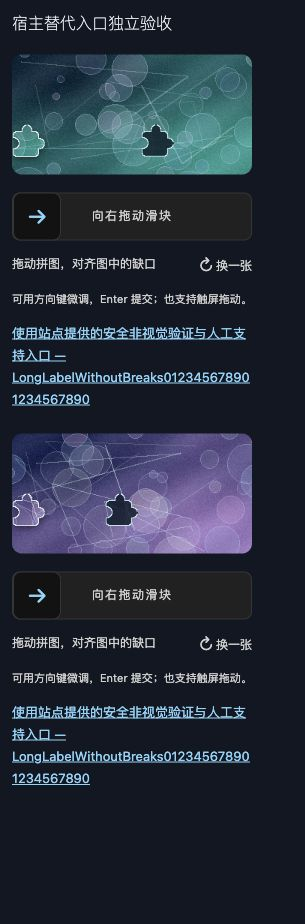
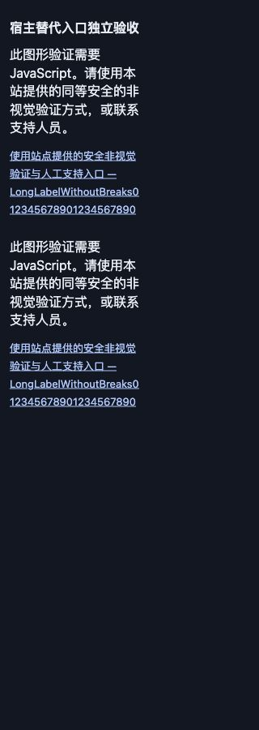

# 2026-10-26 后续接入与出图主控独立验收

结论：本轮约定范围已完成，主控复核与独立验证通过，未发现阻塞项。沿用 GPT-6.1 SOL 实施会话完成代码与自测，本会话负责范围、审查、独立环境和真实浏览器验收。多语言暂不处理；本轮未提交、推送、打 tag、上传 PyPI 或部署。

基线为 `main` / `f3edfee149e06c02d5508622583ba05775b32db7`，验收对象是其上的未提交变更。开始时已有诊断复核报告及索引行，均保留。实施代码冻结后主控制作独立源码快照、构建自己的 wheel/sdist，在六个任务专用 venv 内验证；结束时重新比对57个源码、测试、脚本、依赖和工作流文件哈希，确认测试后没有漂移。后续仅补本文与文档索引，不改变运行代码。

## 完成范围与审查结论

| 改动 | 主控结论 |
|---|---|
| 核心与演示 URLConf 分离 | 默认核心仅 api-root / init / challenge / verify；根路径不创建会话，submit/demo 不再默认暴露。显式演示的消费固定为 demo，不能消费 login 凭证。 |
| Widget 命名空间 | 使用命名 api-root，可指定完整 namespace；保留 script prefix、完整字段名和独立组件 endpoint。演示提交使用 form.action。 |
| Pillow 与 CI | Pillow `>=12.2,<13`，独立实测12.2.0/12.3.0；六组代表性配对覆盖声明的 Python/Django 系列。同一构建 wheel 安装测试。 |
| 字段配置 | required=False / disabled=True 构造时给出明确 ValueError；后续变更仍拒绝放行且不消费凭证。复核 errors/full_clean 保护注释，保留既有缓存失效与事务语义。 |
| 图像生成 | Pillow C 层处理代替全图 Python 像素循环，未增加 NumPy。坐标仍使用 secrets，装饰种子每题新建，尺寸/PNG/原轮廓保留。 |
| 宿主替代入口 | 可配置全局或每个 Widget 的本地导航链接，模板强制转义，JS 开关均可见。只导航，不内置替代认证、不签发或跳过凭证。 |
| 部署与清理 | 新增受信代理的 REMOTE_ADDR 映射说明、Django check --deploy 和 prune 成功心跳/表增长监控指引。没有开放任意转发头信任或新增后台调度。 |
| 包边界 | 删除空 templatetags，新增 demo_urls；29个运行文件内容、完整集合与依赖元数据一致。publish.yml 字节不变，保留同一 artifact 与最小 OIDC 权限。 |

**兼容变化需要接入方处理**：旧 `nova_slider_captcha:demo` 反解名改为 `nova_slider_captcha:api-root`；原核心挂载下的 submit/demo 消费不再存在。需要演示时显式挂载 `nova_slider_captcha.demo_urls`；本仓库示例路径为 `/captcha-demo/`。迁移、命名空间组合及 Admin 替代入口示例已写入 README/RELEASING。

## 独立自动化验证

以下结果由主控自行运行，不把实施自测计入。所有数据库为任务专用 SQLite，未使用示例或生产数据库。wheel 模式使用 `PYTHONPATH=.` 与 `python -m django`，断言导入来自安装位置而非 src。

| Python | Django | Pillow | 源码 | 同一 wheel |
|---|---|---|---:|---:|
| 3.10.20 | 5.2.17 | 12.2.0 | 122通过 | 122通过 |
| 3.11.12 | 5.2.17 | 12.3.0 | 122通过 | 122通过 |
| 3.12.14 | 5.2.17 | 12.3.0 | 122通过 | 122通过 |
| 3.12.14 | 6.1.2 | 12.2.0 | 122通过 | 122通过 |
| 3.13.12 | 6.1.2 | 12.3.0 | 122通过 | 122通过 |
| 3.14.7 | 6.0.9 | 12.3.0 | 122通过 | 122通过 |

每个 profile 的依赖检查、Django check、makemigrations --check --dry-run 均通过，完整测试零跳过。这是六组配对，不是所有版本的笛卡尔积。

| 其他主控检查 | 结果 |
|---|---|
| 独立专项 probe | 源码及安装 wheel 各9项通过；wheel日志留存 |
| Node 组件测试 | 41项通过 |
| jsdom + 真实 Django test client | 12项通过，含显式演示、Admin、CSRF、重放及异步竞态 |
| 本地 Worker | 25项通过 |
| 主控独立 build / twine --strict | wheel与sdist通过 |
| check_release --dist --tag v0.3.0 | 29个运行文件集合/字节、元数据和链接通过 |
| 包检查负向探针 | 添回空 templatetags 文件、把 wheel Pillow 元数据改回精确锁定，分别被集合检查和依赖检查拒绝 |
| actionlint 1.7.12 | 两工作流零诊断 |
| 冻结与差异检查 | 57文件一致；git diff --check通过 |

9项主控探针单独覆盖：仅核心挂载且不创建会话、namespace/script prefix、危险/非绝对替代 URL、SafeString 强制转义与全局/单组件隔离、字段构造及运行时变更、8张新鲜 PNG 及无答案元数据、demo 对 login 凭证的拒绝且不消费、CSRF/一次消费重放、字段变更不消费合法凭证。

已测主控 wheel SHA-256：`b479743e09a6ca756ed4ef384ffce171f85bc5038c8e1102fe47ec8b272d664e`。完整分发哈希在 artifacts.json；未上传这些本地构建物。

## 真实浏览器与主控反馈修复

使用 loopback 临时 Django WSGI 夹具、真实组件静态资源与真实本地 API，320px 视口、160/240px 容器、同页两个 Widget、长中英文宿主标签。没有访问公开演示或完成第三方 CAPTCHA。

六组检查覆盖：显式 light + OS dark、显式 dark + OS light、Nova light/dark、auto + OS dark、加载实际 Django Admin CSS 的 dark。链接在容器内换行，文档无横向溢出，两个完整字段名分别为 first-proof / second-proof。浅色链接对背景对比度6.70，独立暗色10.50，Django语义色10.89，均超过普通文字4.5阈值；此结论只适用于实测主题，任意宿主自定义颜色仍需验收。

另用浏览器实际禁用 JavaScript：两个替代链接与 noscript 均可见，原生点击可到达本地宿主支持页面。该夹具目的页仅显示支持说明，没有认证或业务副作用；这验证导航可用，不等于宿主已经实现替代身份核验服务。检查结束恢复脚本、媒体偏好和视口，关闭临时页面并停止本轮服务器。

主控反馈并复验了两处修正：

- 原先只验证解码 URL 会允许 `%2Fhelp/`，浏览器却将原串作为相对地址。现在同时要求原始 URL 与解码 URL 都以单个 `/` 开头。
- 替代链接位于组件外，最初没有继承组件内部暗色变量，暗色对比度约2.68。现在在包装层提供明暗兜底，保留宿主语义变量及显式主题优先级。





## 独立性能复测

审读基准脚本后在同一 Python3.12.14/Pillow12.2.0 进程，预热后交错运行基线与当前各25次，每组相同合成种子、轮换先后次序。没有请求线上服务。以下为中位数，外部机器负载无法完全控制。

| 指标 | f3edfee 基线 | 当前 |
|---|---:|---:|
| make_puzzle 总耗时 | 66.62 ms | 6.91 ms |
| 两张PNG保存合计 | 5.98 ms | 5.62 ms |
| 背景PNG大小 | 92,713 B | 85,784 B |
| 拼图PNG大小 | 4,630 B | 4,653 B |

总耗时中位减少约89.6%。已查看左右合成对照及真实浏览器中的图像，缺口和拼图可辨识。结果只证明本地出图热点改善，不推导生产吞吐、用户可用性或抗自动化效果；PNG大小也不是安全或画质评分。

## 范围与证据

slider.js（含语言字典/normalizeLocale）、po/mo、services.py、models.py 和全部迁移与 HEAD 字节一致。没有开展多语言修复、行为轨迹评分、Redis后端、形状库、DRF/allauth、短信/邮件/音频服务等扩展。当前仍为0.3.0待发布。

未运行远端 GitHub Actions、生产部署/代理/调度、PostgreSQL/MySQL、移动真机或辅助技术验收；未执行 PyPI 账号/publisher配置、上传或 Release。部署指南做了文档/代码复核；实施会话的合成 Uvicorn 探针见其自测报告，不计作本主控运行的代理或生产验证。视觉链接检查不构成完整无障碍认证。

证据位于 [本轮独立验证目录](../verification/2026-10-26-followup-independent/)：summary.json和12份矩阵日志、probe.py/probe-wheel.log、component/dom/worker日志、browser.json与截图、images-benchmark.json/对照图、build/twine/package-check/actionlint日志、package-negative.json、freeze-check.json、artifacts.json。

主要复现入口（输出目录应新建；各解释器须已安装对应依赖）：

```sh
# matrix.py 的 JSON 输入为 [{"name":"...","python":"/absolute/venv/bin/python","versions":"..."}, ...]
python verification/2026-10-26-followup-independent/matrix.py \
  /absolute/source-snapshot /absolute/environments.json /absolute/built.whl /absolute/new-output
PYTHONPATH=. DJANGO_SETTINGS_MODULE=tests.settings NOVA_TEST_DB=/absolute/private.sqlite3 \
  /absolute/wheel-venv/bin/python /absolute/repository/verification/2026-10-26-followup-independent/probe.py
PYTHONPATH=src:. python scripts/benchmark_images.py --baseline-ref f3edfee \
  --iterations 25 --output /absolute/new-benchmark.json --preview /absolute/new-comparison.png
```

安装包专项探针的工作目录须包含 tests 且不能把 src 插入 Python 搜索路径。浏览器夹具仅供本地复查，必须使用独立 NOVA_TEST_DB，不是产品入口或认证替代服务。
