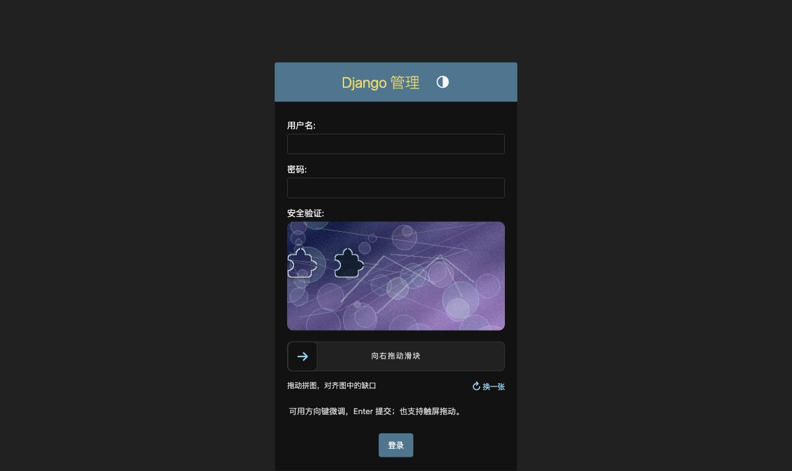

# 2026-10-26 可选链接降级与覆盖率主控独立验收

结论：用户授权的两项工作已完成独立验收，未发现阻塞项。继续由原 GPT-6.1 SOL 实施会话修改，本会话负责范围与复核。本轮没有调整 TOKEN_TTL、几何或多语言，没有提交、推送、发布或部署。

基线为 `011c0fd4a3a298c1c3a00549b25a8e66b3fe7337`。主控从原提交归档测量基线，另建立自己的环境、源码快照和安装包。实施冻结后，64个运行代码/测试/工具/工作流/构建配置及README文件哈希与已验收内容一致；此后仅整理报告、索引和证据；提交准备时另清除 tests/test_optional_link_fallback.py 末尾多余空行，AST比对一致，格式清理前后哈希记入freeze-check.json。实施自测不计入以下主控结果。

## 可选链接降级

`configured_alternative_link()` 与 E007 仍严格拒绝非法全局配置。仅 Widget 渲染读取全局可选链接时捕获配置 ValueError，保留空链接状态；有效的显式 Widget 配置不读取全局设置，显式非法参数仍构造失败。其他运行错误、反解错误继续抛出。

固定 WARNING 事件为 `optional_link / configuration_invalid`，action为render，status=200表示渲染降级仍可用。一个进程最多每300秒记录一次，使用一个时间戳与短锁，不缓存验证结果；日志调用在锁外，失败也不反复重试。多进程各自计时，不宣称跨worker去重。记录不含URL、标签、请求、凭证或异常文本。

独立验证包括：

- 同一份7项契约探针在011c0fd上出现1个失败、3个错误，确认能检出已知500问题；本轮源码与安装wheel均7项通过。
- 非法全局链接下Admin GET为200，危险链接及标签不进入HTML，E007与直接验证器仍拒绝。
- 同一Widget的合法→非法→合法配置动态恢复，不缓存校验结果；显式覆盖仍有效，编程及路由错误不被吞掉。
- 缺少凭证的登录不会调用密码认证backend；普通表单仍必须消费真实绑定凭证，重放失败；非法挑战策略仍返回503。
- 源码与wheel均完成32次并发渲染：第一个300秒窗口仅一次告警，边界后恢复告警。实际执行一次抛错日志处理器后页面仍可渲染，重复渲染不重复调用失败处理器，合法配置立即恢复链接。

浏览器使用独立loopback WSGI/SQLite，在宿主全局配置故意非法时访问真实Admin登录页。页面正常显示，组件为ready，实际点击“换一张”成功取得新题；替代链接数量为0，隐藏凭证字段只有一个且为空。未输入账号密码、未完成验证码或登录。结束后关闭临时页并停止本次服务。

## 独立覆盖率测量

主控前后比较使用 **Python3.12.14 / Django5.2.17 / Pillow12.2.0 / coverage.py7.17.0**，包含整个源包、迁移和升级测试子进程，不排除语句或分支。

| 范围 | 011c0fd原122项测试 | 本轮134项测试 |
|---|---:|---:|
| 包整体语句 | 634/651，97.39% | 658/669，98.36% |
| 包整体纯分支 | 153/160，95.625% | 160/164，97.56% |
| forms.py语句 | 125/131，95.42% | 138/138，100% |
| forms.py纯分支 | 37/40，92.50% | 42/42，100% |

最初只测主进程的基线为整体622/651语句、148/160分支；该初测单独保留，不用于上表比较。启用子进程采集后补回升级测试中实际执行的代码，两个正式比较点均使用同一统计口径。配置依据 [coverage子进程说明](https://coverage.readthedocs.io/en/latest/subprocess.html)。

主控还将自己构建的sdist解包，在独立 **Python3.12.14 / Django5.2.17 / Pillow12.3.0 / coverage.py7.17.0** 环境按CI profile执行：134项通过，覆盖率计数与本轮主控12.2.0结果一致，HTML/JSON/XML均生成，门槛通过。这验证sdist中的开发配置可复现，不把两个Pillow环境混为一个。

当前forms无缺失语句或分支。包整体剩余11条语句、4个分支主要在middleware缺失检查、无效日志级别回退、非法purpose签发以及少量HTTP输入/限流错误路径。完整缺失明细见current-coverage.json。100%覆盖不证明所有输入或安全性质正确，仍需保留真实行为断言与代码审查。

## 门槛与CI复核

新增工具仅为开发/CI依赖，不进入Python运行元数据；没有引入ruff或mypy。使用原始整数分别计算语句和纯分支比例，避免把coverage report的组合覆盖率当作纯分支；两者含义见 [coverage分支统计说明](https://coverage.readthedocs.io/en/latest/branch.html)。

| 范围 | 语句门槛 | 纯分支门槛 |
|---|---:|---:|
| 包整体 | 97% | 95% |
| forms.py | 99% | 97% |

主控执行仓库的12种负向检查，又用独立构造的8个反例验证：四条门槛分别触发对应拒绝；即使JSON显示百分比写成100%，低覆盖计数仍不能通过；空报告、无branch、缺源文件和错包路径均被拒绝。低覆盖反例保持明细和汇总计数一致，避免只是命中格式错误。

另外模拟采集进程以7退出：后续combine、HTML/JSON/XML生成均成功，覆盖率gate以1退出。配合工作流检查确认测试步骤没有continue-on-error，报告/gate/artifact使用always()，不会将原测试失败改成成功。该模拟验证本地报告生成机制，不是远端Actions执行证据。

原六格source/wheel测试及同一artifact关系保留；发布工作流与基线字节一致，OIDC job未增加执行代码。coverage单独在Python3.12/Django5.2.17/Pillow12.3.0运行，报告artifact独立，数据库在artifact目录之外。sdist包含配置、开发依赖文件和检查脚本，wheel仍只有29个运行文件及原运行依赖。

## 主控其他验证

| Python / Django / Pillow | Source | 同一wheel |
|---|---:|---:|
| 3.10.20 / 5.2.17 / 12.2.0 | 134通过 | 134通过 |
| 3.11.12 / 5.2.17 / 12.3.0 | 134通过 | 134通过 |
| 3.12.14 / 5.2.17 / 12.3.0 | 134通过 | 134通过 |
| 3.12.14 / 6.1.2 / 12.2.0 | 134通过 | 134通过 |
| 3.13.12 / 6.1.2 / 12.3.0 | 134通过 | 134通过 |
| 3.14.7 / 6.0.9 / 12.3.0 | 134通过 | 134通过 |

每格依赖检查、Django check、迁移漂移检查通过，完整测试零跳过。wheel强制重装，并断言导入路径来自安装位置；没有通过manage.py插入源码冒充安装包测试。

组件41项、Django-client/jsdom DOM12项、actionlint、build、twine --strict、29文件包一致性和sdist开发工具检查均通过。Worker实现未改变，本轮主控未重复Worker测试。主控wheel SHA-256：`ee4221600ae9f445e08b412cba65941661bddf379f2610aec3fc1eaf72c8c7ee`。

除forms.py/events.py外，其他27个运行文件与基线逐字节一致；Field、FormMixin、AdminAuthenticationForm三个验证类的AST也与基线一致。TOKEN_TTL、几何、语言字典/翻译、服务、模型、迁移与前端资源保持原样。

## 证据与限制

[本轮独立证据](../verification/2026-10-26-residual-independent/)包括基线与当前覆盖率JSON/日志、12份矩阵日志及summary.json、7项probe的修复前后结果、日志并发探针、门槛反例、失败报告探针、浏览器JSON/截图、构建/包检查与freeze-check.json。覆盖率HTML/XML和原始采集数据只保留在任务临时输出，CI将提供自己的可下载artifact；仓库留机器摘要和必要复现脚本。

复现覆盖率按 [COVERAGE.md](COVERAGE.md)；主控matrix.py接受源码目录、包含六个解释器/版本的JSON、wheel、新输出目录。probe.py需tests.settings及私有NOVA_TEST_DB；安装wheel模式必须使用PYTHONPATH=.，工作目录包含tests且不自动加入src。log_probe.py为合成时钟/并发探针；browser_fixture.py仅为loopback验收，不是产品入口。

未执行远端GitHub Actions、PyPI发布、生产代理/调度/负载、PostgreSQL/MySQL、移动真机或辅助技术验收。当前版本仍0.3.0待发布。所有本地运行使用任务专用环境和数据库，工作区保持未提交，历史报告/证据未改写。
